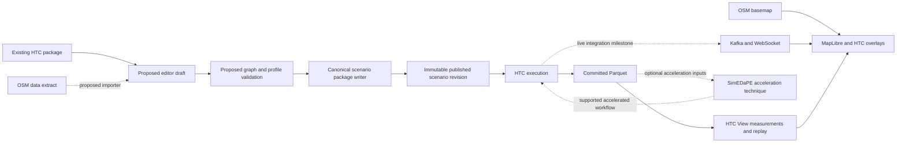

# HTC map editor — feature proposal

Recorded 2026-11-01 in response to the request for real-time execution, OpenStreetMap
visualization and a documented map editor. **The bounded entity/network editor is now
implemented at `/modifications`**, including road/signal/transit/demand editing, drafts,
undo/redo, validation and publication. See [implemented workflow and evidence](SCENARIO_ENTITIES_EDITOR.md).
The broader GIS/editor requirements below remain the proposal beyond that implemented profile.
The existing map renderer, native measured-run workflow and run-bound replay are reusable.
This document is a concrete starting point for the user's feature ideas, not a claim that
every listed feature is already agreed or supported.

## Purpose and first release

Create, inspect and change an HTC scenario in standalone or OSM-backed mode, then
validate, publish a new scenario revision, run HTC and inspect that run's results/replay.
Edits belong to the HTC project and produce a new revision. There is no public OSM editing
or uploading in this workflow.

The user clarified two required modes: standalone networks and OSM-backed networks with
actual road compatibility. The [map modes and compatibility contract](SIMULATION_MAP_MODES.md)
is authoritative: an OSM background alone does not satisfy the second mode. The revised first
OSM milestone is source mapping, retained road geometry, road-following vehicles and a joined
road/link inspector, before claiming a completed OSM editor.

The editor's real-engine proof covers bounded MICRO/MESO roads, signals, bus stops/terminal,
metro stations/rails, dynamic vehicle dispatch and walking/public-transport demand on one-second
ticks. The separate [managed live adapter](MANAGED_LIVE_RUNS.md) retains its fixed-route car
profile. Publishing a multimodal revision does not extend that adapter's measured/live scope.

## User journey

1. Open **Map editor** (proposed route `/editor`) and create a project or clone a scenario.
2. Choose standalone or OSM-backed mode. See the corresponding network/context and a clear
   source/synthetic-data label; OSM-backed publication requires the compatibility checks.
3. Select an intersection, directed road, signal or demand item. Edit its properties in a
   side panel, or use drawing/snapping tools for supported topology changes.
4. Save the draft and use undo/redo. Validation highlights errors on the map and lists the
   affected entities with fixes; saving an incomplete draft is allowed.
5. Publish a validated immutable revision. Review the changes and the execution profile.
6. Start full HTC from that revision. Follow progress and open measured series or map replay.
   Offer live viewing only when the run's streaming prerequisites are available.
7. Make further changes in a new draft and run another revision. Existing run inputs/results
   remain bound to the revision that produced them.

## Editing surface

| Item | First-release behavior |
|---|---|
| Map mode | Standalone independent network, or an OSM-backed network with source mapping and preserved road geometry. Background selection is separate from compatibility validation. |
| Basemap | Independent background in standalone mode; OSM context with attribution for matching OSM-backed scenarios. Pan and zoom in both. |
| Intersections | Select/create/move nodes, with snapping. Keep IDs stable. A geometric crossing becomes a junction only through an explicit connect operation; bridges/tunnels remain separate. |
| Directed roads | Select endpoints/direction; edit length in metres and speed limit in km/h. A two-way road has two directed links. Show unsupported lane/model choices rather than silently applying them. |
| Topology | Connect/disconnect nodes and split/delete roads as atomic operations. Show affected routes and signal approaches; publication requires repaired references. |
| Traffic signals | Select controlled incoming approaches; edit cycle, offset and phase timing with a phase preview. Validate references and timing against the simulation clock. |
| Demand | Add a bounded set of standalone cars or a deterministic OD/departure generator. Preview departures and fixed connected routes before publishing. |
| Simulation settings | Horizon, seed and supported profile. Label physical tick duration separately from playback speed and proposed wall-clock pacing. |
| Measurements | Select links and variables to inspect after execution. Existing physical units and missing-value masks remain unchanged. |
| Revision comparison | Show moved/added/removed nodes, changed link properties, signals and demand. Require explicit handling of routes affected by removed links. |

For a first bounded MICRO demonstration, restrict creation to the validated single-lane
profile. Preserve unsupported imported fields as read-only or reject publication with a
specific explanation. Do not silently remove transit, owners, dynamic-mode settings or other
actors from an imported scenario to make it fit the current native adapter.

## Geometry and data contract

- Canonical graph entities own topology; GeoJSON features are their editing/rendering view.
  Drawing a line is not sufficient to produce valid Link/Node actors and a routing graph.
- Store geographic display coordinates in EPSG:4326. GeoJSON coordinate order is
  `[longitude, latitude]`; HTC Node fields are named `longitude` and `latitude`. Retain the
  declared source CRS and transformation when importing projected data. Reject unknown CRS
  instead of guessing. Range checks alone cannot prove that coordinates are geographic.
- Keep physical road lengths in metres and speed limits in km/h. Compute geodesic/metric
  lengths deliberately, not from pixels or degree differences. Review imported length
  conventions and any manual override.
- Preserve complete road polylines in a proposed sidecar `geometry.geojson`, keyed by stable
  link identity. Current HTC replay uses straight endpoint links; displaying/interpolating
  along retained curves requires a renderer/ETL extension. Do not silently turn every OSM
  shape vertex into a simulated intersection: that changes the model's topology and timing.
- Keep editor/HTTP identifiers as decimal strings so JavaScript does not round 64-bit IDs.
  A server-owned ID registry validates and emits the engine's signed 64-bit integer IDs.
  Keep OSM IDs separately, including their entity type and split-segment mapping.
- Route edits update the ordered directed-link sequence and corresponding HTC fixed-route
  representation. Rebuild node connections, signal references and `city_map.json` together.
- Published runs record revision identity and input hashes. Editing the catalogue cannot
  change a previous run's geometry; reuse the materialized-snapshot replay contract.

## Importing real OSM roads

Add this as a separate, bounded import workflow after the existing-scenario editor works:
select an area, obtain an explicit road-data extract, preview conversion assumptions, and
create a draft. Tiles are images of the map, not a road-network import API.

Preserve OSM node/way IDs, extraction date, source extent, tags used, missing-tag defaults
and excluded features. Convert one-way directions, speeds and units, lanes, allowed modes,
grade-separated junctions and supported turn restrictions explicitly. Missing demand,
signal phases and unsupported restrictions need visible assumptions or blocking errors;
they cannot be inferred reliably from a background map.

Retain source/licence/attribution metadata with the project and exported package. OSM data
uses ODbL and requires attribution; consult the official [copyright and licence page](https://www.openstreetmap.org/copyright)
when defining an import/export product. Tile-service constraints are covered separately in
[Real-time and maps](REAL_TIME_AND_MAPS.md).

Reuse the platform's OSM/scenario preparation logic where appropriate, but do not present
the existing city-scale São Paulo/Toulouse generators as a finished interactive import API.
Bound area size and preview costs before scheduling import/conversion.

## Implementation boundaries



HTC Platform is the platform, HTC is its simulation engine, HTC View is a platform component,
and SimEDaPE is an acceleration technique. Full-run management/replay does not itself execute
SimEDaPE. Some management code currently lives in the `simedape` repository; that code location
must not define the component responsibilities or product labels.

Reuse HTC View (`htc-ui`) for the editor page, map, entity panels and run/result navigation. Proposed
Next.js `/api/editor/*` routes manage local project metadata and invoke a Python scenario
utility under `tools/scenario-editor/`. The utility owns graph validation and compilation,
and uses the existing shared [scenario output writer](../../tools/scenario-db-converter/scenario_output_writer.py).
It should not duplicate actor-package schemas inside React or add scenario-authoring
responsibilities to SimEDaPE's estimator.

Publish the canonical package:

```text
<scenario-revision>/
  simulation.json
  scenario_metadata.json
  GENERATION_REPORT.md
  geometry.geojson          # proposed retained display geometry
  data/
    nodes_0.json
    links_0.json
    traffic_signals_0.json
    cars_0.json
    city_map.json
```

Use the engine's [scenario model](../../hyperbolic-time-chamber/docs/SCENARIO_MODELING.md)
and current state classes as the schema reference. Existing documentation may contain
historical implementation notes; verify generated fields against code and a real bounded
run. JSON publication is the initial target; SQLite export is a later adapter using the
existing converter.

### Proposed API, not current endpoints

| Route | Responsibility |
|---|---|
| `POST /api/editor/projects` | Create a project from a supported scenario or an empty draft. |
| `GET /api/editor/projects/<id>` | Load draft graph, properties, source metadata and revision. |
| `PATCH /api/editor/projects/<id>` | Apply a typed editing operation with expected revision; return conflict on stale writes. |
| `POST /api/editor/projects/<id>/validate` | Return graph/profile errors and nonblocking warnings tied to entity IDs. |
| `POST /api/editor/projects/<id>/publish` | Compile a new immutable scenario package after successful validation. |
| `POST /api/editor/imports` | Later-phase bounded OSM import job, producing a draft. |

The server owns filesystem locations and safe publication names. A draft operation is an
atomic graph change, so undo restores connected references rather than just redrawing a
feature. Publishing uses a temporary output plus atomic promotion and never overwrites a
revision referenced by a run. The draft remains intact if validation/export fails.

## Validation and acceptance

Block publication for duplicate/out-of-range IDs; invalid coordinates; missing endpoints;
nonpositive lengths/speeds; incompatible model/clock choices; dangling node, route or signal
references; disconnected fixed routes; or departures outside the run horizon. Validate
model-specific limits against the engine rather than inventing new defaults. Require an
explicit decision for isolated network components and for demand affected by topology edits.

The first acceptance demonstration should:

1. Clone the geographic corridor fixture and show it on the OSM background with attribution.
2. Change a speed limit and signal phase; move a node; save, undo/redo and reload the draft.
3. Reject a deleted road still referenced by a car route, then allow publication after repair.
4. Publish a new revision and execute it through the existing full HTC workflow in HTC View.
5. Check actual vehicle departures, the selected revision's geometry/report hashes, physical
   units and missing values; open its replay and ensure the previous run remains unchanged.
6. Complete browser/WebGL acceptance with map navigation, forms, attribution visibility and
   replay playback/scrubbing. API/build checks alone are insufficient.

Live acceptance is an additional milestone from [Real-time and maps](REAL_TIME_AND_MAPS.md):
events before completion, run-isolated subscriptions, correct geometry and explicit lag.
True 1× engine pacing is a separate feature. Accuracy tuning remains after the requested
functional integration and editor behavior work.

## Delivery order

1. Standalone network inspection plus the OSM-backed source/geometry compatibility contract.
2. Bounded OSM import, retained-polylines, road-following vehicles and joined road/link picking.
3. Draft editing, atomic topology operations, validation, canonical publication and full-run/replay handoff for both modes.
4. Native live-run integration; engine wall-clock pacing if that is the intended real-time requirement.
5. Broader actors/input formats and approximation controls as specified, followed by accuracy work.

No real-time pacing, editor page, editing endpoints or OSM road importer was added by this
documentation change. The OpenStreetMap basemap configuration is implemented separately
and shared by the existing live/replay viewers.
